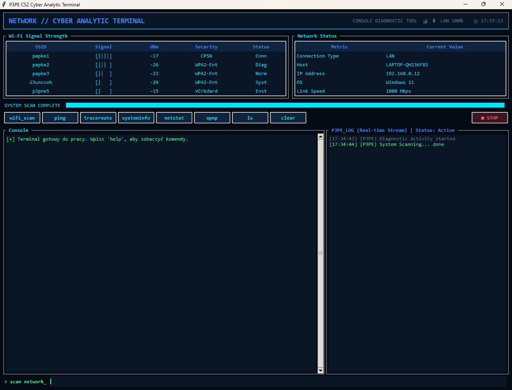

# 🖥️ P3PE CS2 Cyber Analytic Terminal

**P3PE Cyber Analytic Terminal** to autorski, okienkowy terminal diagnostyczny w stylu retro-sci-fi, stworzony w języku Python (Tkinter). Aplikacja łączy narzędzia sieciowe wykorzystywane w codziennej pracy **IT Support / Helpdesk** z bezpiecznym systemem zarządzania plikami (Sandbox).


*(Wskazówka: wrzuć zrzut ekranu swojego terminala jako `screenshot.png` do głównego folderu repozytorium, aby wyświetlał się w tym miejscu)*

---

## 🚀 Szybki Start (Instrukcja uruchomienia)

Projekt bazuje wyłącznie na wbudowanych bibliotekach standardowych Pythona 3 (`tkinter`, `socket`, `subprocess`, `threading`, `queue`), dzięki czemu **nie wymaga instalowania żadnych zewnętrznych paczek przez `pip`**.

1. **Sklonuj repozytorium i wejdź do folderu:**
   ```powershell
   git clone [https://github.com/Piotr1983111/p3pe-cs2-terminal.git](https://github.com/Piotr1983111/p3pe-cs2-terminal.git)
   cd p3pe-cs2-terminal